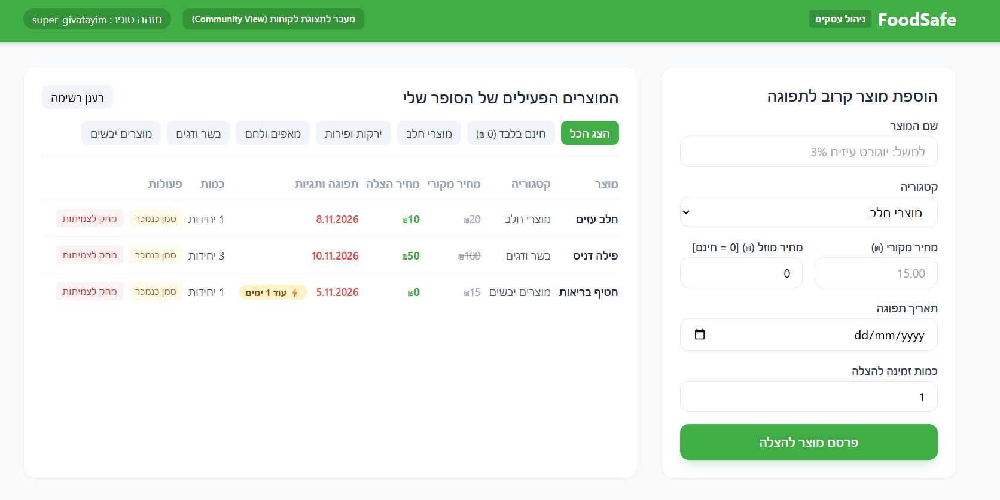
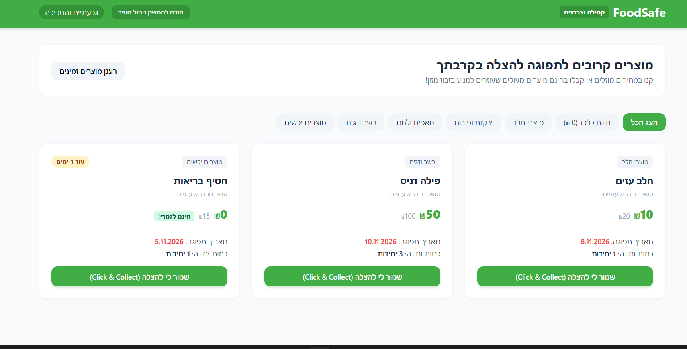

#  FoodSafe - Smart Supermarket Food Rescue Platform

FoodSafe is a full-stack web application designed to manage and rescue surplus supermarket food, connecting businesses and communities efficiently to reduce food waste.

---

##  Screenshots
*(מומלץ להעלות את התמונות לתיקיית `assets/` בפרויקט או לגרור אותן ל-Issue בגיטהאב כדי לקבל קישור זמין)*

| Merchant Dashboard | Customer View |
| :---: | :---: |
|  |  |

---

##  Tech Stack

### Frontend & UI
* **HTML5 / CSS3 / Tailwind CSS** - Modern, responsive, and clean green-themed user interface (`#40ad45`).
* **JavaScript (Vanilla/ES6)** - Dynamic client-side logic and API integration.

### Backend & Database
* **Node.js & Express.js** - RESTful API server architecture.
* **MongoDB Atlas** - Cloud-hosted NoSQL database with secure connection management.

### DevOps & Infrastructure
* **Docker & Docker Compose** - Containerized development and deployment environment.
* **Kubernetes (K8s)** - Orchestration configuration manifests for scalable deployments (located in `/k8s`).

---

##  Project Structure

```text
foodsafe/
├── foodsafe-backend/       # Node.js & Express REST API server
│   ├── models/             # Mongoose database schemas
│   ├── routes/             # API endpoints
│   ├── Dockerfile          # Backend container image configuration
│   └── server.js           # Application entry point
├── foodsafe-merchant-web/  # Frontend web client (HTML/CSS/JS)
├── k8s/                    # Kubernetes configuration manifests
│   ├── backend-deployment.yaml
│   └── backend-service.yaml
└── .gitignore              # Security and exclusion rules


Security Practices
Environment Protection: Sensitive credentials (such as MongoDB connection strings) are strictly managed via local .env variables and excluded from version control using .gitignore and .dockerignore.

Kubernetes Security: Deployment manifests utilize secure environment variable placeholders to ensure public repository safety.

 Getting Started Locally
Clone the repository:

git clone [https://github.com/nomily23/foodsafe.git](https://github.com/nomily23/foodsafe.git)
cd foodsafe

2.Configure Environment Variables:
Create a .env file inside the foodsafe-backend/ directory with your connection details:

PORT=5000
MONGO_URI=your_mongodb_connection_string_here

3.Run with Docker:

docker-compose up --build